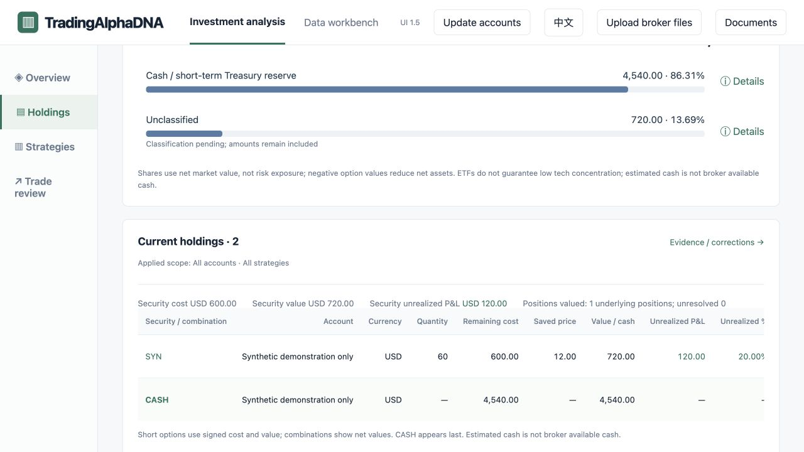

# TradingAlphaDNA (TAD)

**See what your stock and options trades actually earned.**

> **Your broker data stays on your computer.** In the current local TAD app, broker files and account data are imported, processed and saved on your own computer—not uploaded to a TAD cloud service. The interface's “Upload” action submits files to the app running on your computer. Sharing anything yourself through public feedback, email or an external service is a separate action.

> **券商数据留在你的电脑上。** 当前本地版 TAD 在你的电脑上导入、处理和保存券商文件与账户数据，不会上传到 TAD 云端。界面中的“上传”是把文件交给本机运行的程序；用户自行通过公开反馈、邮件或外部服务分享资料，是另外的动作。

Your broker lists transactions and positions. But when a stock holding, option trades and several accounts are involved, the questions get harder: How do the gains and losses add up? How much capital did they use, and for how long?

TAD connects related trading records so investors can review profit and loss, returns and capital use by account, stock and strategy.

[See the product](https://tradingalphadna.github.io/tad-showcase/) · [Request a demo](mailto:hhuang68@gmail.com) · [Engineering case study](docs/engineering-case-study.md)

## Mac technical preview · Mac 公开测试

**[Download 1.1.0-alpha.1](https://github.com/TradingAlphaDNA/tad-showcase/releases/tag/tad-test-v1.1.0-alpha.1) · [English guide](docs/testing/README.en.md) · [中文说明](docs/testing/README.zh.md) · [Report a test result](https://github.com/TradingAlphaDNA/tad-showcase/issues/new?template=technical-preview.yml)**

**Ad-hoc signed · NOT notarized / 临时签名，尚未公证.** macOS may block first launch; record the warning and contact the project. Do not disable system protections to run this preview.

| Coverage | Scope |
| --- | --- |
| Planned / 计划支持 | Apple Silicon M1 and later M-series; release macOS 15, 26 and 27 |
| Verified / 已实测 | Development Mac on macOS 15.2; constructed cases and independent same-Mac review |
| Pending / 待验证 | Test users’ own Macs, Finder installation and browser-download/security prompts |

No Git, Python, Node or private repository access is required. The download includes the unchanged application **1.1.0-tester-review.1**, synthetic broker files, bilingual instructions and a test checklist. Start with those samples in a new personal environment. [Preview evaluation notice](docs/testing/TESTING-NOTICE.md).

This is a public prerelease, not a promise that every target chip/OS combination works. Share only sanitized feedback; keep account details, broker originals and backups out of public issues. **公开预发布，用户环境兼容结果仍待反馈；请勿公开账户资料或券商原件。**

### Importing broker data / 券商数据导入

**[Supported files and limits](docs/testing/broker-support.en.md) · [Export the right files](docs/testing/broker-export.en.md) · [Evaluate your own data](docs/testing/personal-data.en.md)**

**[中文支持矩阵](docs/testing/broker-support.zh.md) · [中文导出指南](docs/testing/broker-export.zh.md) · [真实数据上手](docs/testing/personal-data.zh.md)**

Moomoo, Chase / J.P. Morgan **investment accounts**, and E*TRADE have independent Connectors for specific CSV layouts. Start with the supplied synthetic cases; optional personal-data evaluation uses a **separate fresh environment** and the online guide. Broker name alone does not guarantee compatibility. PDF statements are archive-only in the ordinary upload flow; a generic TAD import Connector/template is **not yet available**.

**Archived ≠ applied; applied ≠ fully reconciled. / 已归档不等于已应用，已应用不等于全部对账通过。** Check account, date coverage, opening holdings/cash and unresolved items before interpreting results. The support matrix separates implemented readers, actual test evidence and pending real-file compatibility. Existing ZIPs and attached guides remain the unchanged synthetic acceptance kit; these online guides add the personal-data route without a binary rebuild.

## Who it is for

Investors who actively manage stocks and options, especially across brokerage accounts or through strategies such as covered calls, cash-secured puts, PMCC and LEAPS. If you already piece together broker records in a spreadsheet to understand your trades, TAD addresses that work.

## You collected the call premium. How did the whole trade perform?

The stock can lose more than the premium earned. A useful review brings the stock and option results into view together, then asks how much capital was committed and for how long.

TAD lets you follow related trades and inspect their contributions. Some strategies currently show only part of the result; those gaps are marked beside the analysis.

*Actual product screen using artificial demonstration data.*

## Project highlights

- **Product & financial logic:** Designed stock and options review workflows covering strategy contributions, per-stock P&L, trading costs, and capital efficiency.
- **Data architecture & curation:** Designed extensible, layered data models with user review and traceable corrections to improve data quality and support additional brokers and analyses.
- **AI-native development:** Built and iterated the application, coordinating specialized AI agents for implementation, code review, testing, and release.

The project began with a practical trading-review problem and grew into a working local application: broker-data import, trade reconstruction, strategy identification and analysis. The [engineering case study](docs/engineering-case-study.md) explains the product decisions, implementation and validation behind it.

## Explore TAD

- [Bilingual product introduction](https://tradingalphadna.github.io/tad-showcase/) — choose **中文** for Chinese.
- [English PDF](TADIntro.en.pdf) · [中文 PDF](TADIntro.cn.pdf).
- [Latest downloadable presentation](https://github.com/TradingAlphaDNA/tad-showcase/releases/tag/showcase-v1.0.2) — introduction materials, not an application installer.
- [Engineering case study](docs/engineering-case-study.md).

## How it works

Import supported transaction exports from Chase, moomoo or E*TRADE, review the connected trades and holdings, and explore results by account, stock or strategy. Support varies by export format and available history.

The application runs on your computer without a model or API key. Financial calculations use Python rules and Decimal arithmetic. The interface uses HTML, CSS and JavaScript; SQLite retains application and correction history. AI tools assist development and review.

### Help improve TAD

Does TAD address a problem you face when trading options? If you’d like to help us improve it, email us at **[hhuang68@gmail.com](mailto:hhuang68@gmail.com)**. We’ll follow up to learn about your needs and discuss how we can help.

Please don’t include account details or trading records in your initial email.

## Availability and use

**Under active development · [Demo available on request](mailto:hhuang68@gmail.com) · Planned distribution: shareware**

Pricing and usage terms are not yet announced. This public repository contains product presentations, synthetic screenshots and selected engineering explanations. The full application source remains private. The showcase does not release the application as open-source software. Local evaluation of the published technical preview is described in its [evaluation notice](docs/testing/TESTING-NOTICE.md); future general usage and pricing terms are not yet announced.

## Current limitations

Some historical strategy results are incomplete. A short-call premium alone does not describe the whole CC or PMCC trade. Return and capital-efficiency figures show their calculation basis and period.

Prices are saved observations, not live quotes. General statement-PDF extraction, automated trading and a multiuser cloud service are outside the demonstrated scope.
