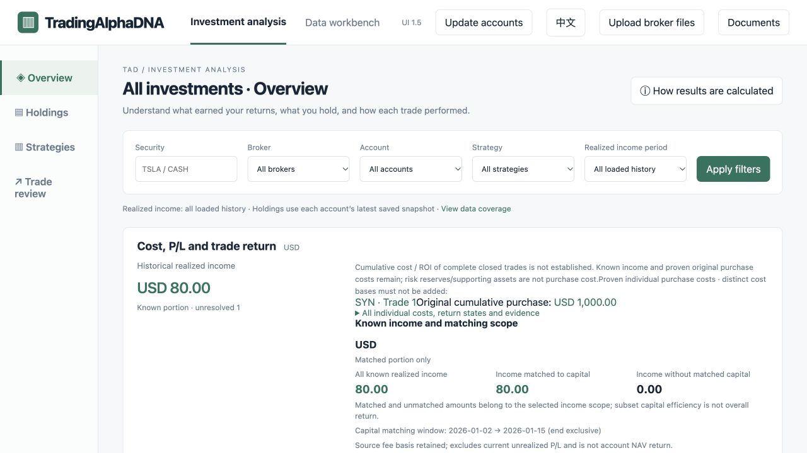
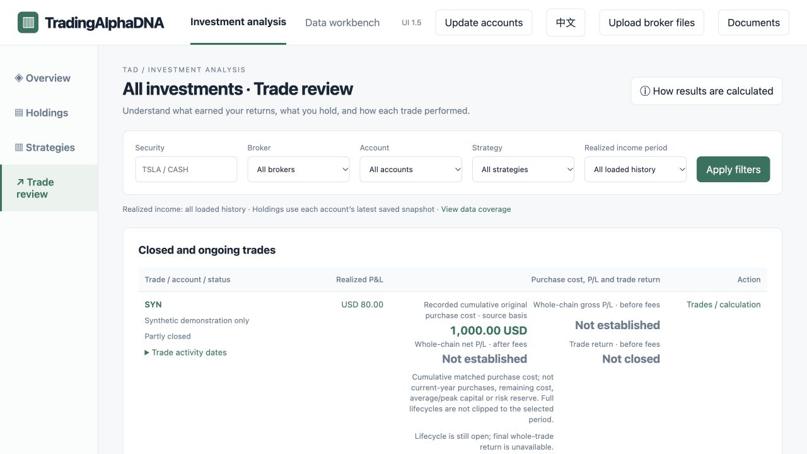

# TradingAlphaDNA (TAD)

**Understand your strategies, per-stock results and capital efficiency.**

TAD is a local application for reviewing stock and options trading across accounts, strategies and individual stocks.

**Under active development · [Demo available on request](mailto:hhuang68@gmail.com) · Planned distribution: shareware**

[View product](https://tradingalphadna.github.io/tad-showcase/) · [Engineering case study](docs/engineering-case-study.md) · [Request a demo](mailto:hhuang68@gmail.com)

Pricing and usage terms are not yet announced.

## Project highlights

- **Product & financial logic:** Designed stock and options review workflows covering strategy contributions, per-stock P&L, trading costs, and capital efficiency.
- **Data architecture & curation:** Designed extensible, layered data models with user review and traceable corrections to improve data quality and support additional brokers and analyses.
- **AI-native development:** Built and iterated the application, coordinating specialized AI agents for implementation, code review, testing, and release.

**Application stack:** Python · Decimal · SQLite · JavaScript/CSS.

*Actual product screen: remaining positions, costs and unrealized P/L at a saved price. The displayed amounts are artificial demonstration values, not investment performance claims.*

This repository presents public product materials and selected engineering decisions. The application source remains private.

## Explore the project

| Start here | What you will find |
| --- | --- |
| [Bilingual product website](https://tradingalphadna.github.io/tad-showcase/) | Browse the product introduction directly; select **中文** for Chinese |
| [English PDF download](https://github.com/TradingAlphaDNA/tad-showcase/releases/download/showcase-v1.0.1/TADIntro.en.pdf) | A four-page overview with actual product screens |
| [中文 PDF 下载](https://github.com/TradingAlphaDNA/tad-showcase/releases/download/showcase-v1.0.1/TADIntro.cn.pdf) | 四页中文介绍：策略表现、个股盈亏与资金效率 |
| [Offline HTML download](https://github.com/TradingAlphaDNA/tad-showcase/releases/download/showcase-v1.0.1/TADIntro.html) | Download the bilingual introduction; keep both PDFs alongside it |
| [Engineering case study](docs/engineering-case-study.md) | Architecture, financial correctness, recovery and validation tradeoffs |

For offline reading, download the HTML and both PDFs above into the same folder, then open `TADIntro.html`.

## The questions TAD helps answer

- **Strategy:** Which traded strategies contributed gains or losses?
- **Stock:** How do stock trades, related options and dividends contribute to one security's result?
- **Capital:** What did a trade cost, how long was capital used, and which return or efficiency measures can be established?

Users can review supported transaction exports from Chase, Moomoo and E*TRADE, inspect holdings and trade chains, and move from a result to the related trades. Support depends on the export format and available transaction history.

More product screens: overview and trade review

## Engineering in brief

The application combines a Python backend with `Decimal` financial arithmetic, SQLite revision and application history, and native JavaScript/CSS browser views. It runs locally without a model or API key. AI assisted implementation and review; deterministic rules produce the financial results.

The [engineering case study](docs/engineering-case-study.md) explains the choices behind incomplete-result handling, repeat imports, supported corrections, source-based rebuilding and workspace recovery.

## Current boundaries

Results retain their scope: period realized profit, current unrealized P/L and complete-trade ROI are different measures. Short-Call income may be only one contribution to a covered-call or PMCC strategy; supporting-asset P/L is separate. Missing information stays visible, rather than becoming zero.

The preview does not promise complete historical returns for every strategy or whole-account growth. Prices are saved observations, not live quotes. General statement-PDF extraction, automated trading and a multiuser cloud service are outside the demonstrated scope.

The private application baseline has passed its CI checks. That validation belongs to the private implementation; this presentation repository does not distribute or execute the application test suite.
