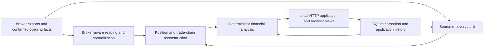

# Engineering TradingAlphaDNA

**Turning broker exports into understandable stock and options analysis.**

[Product introduction](../TADIntro.en.pdf) · [中文介绍](../TADIntro.cn.pdf) · [Project overview](../README.md)

TradingAlphaDNA (TAD) is a local trading-review application for individual investors working across supported Chase, Moomoo and E*TRADE transaction exports. Its product focus is strategy contributions, per-stock results and capital efficiency. This case study describes the private implementation behind the synthetic product demonstration; it does not publish the source code.

## The engineering problem

A broker export is a list of events. A useful trading review needs relationships: which events belong to the same trade, what remains open, what the purchase cost was, and which stock or option positions support a strategy interpretation.

Those relationships must survive incomplete histories, overlapping uploads and different broker conventions. A strategy label also does not establish a complete strategy return. The product must show useful known results while making the affected unknown portion understandable.

The resulting design separates the financial calculation from how confidently a particular result can be established and how it is presented to the user.

## Architecture

Broker-specific reading and lifecycle rules feed shared analysis and presentation capabilities. The implementation still retains broker-specific reconstruction logic where conventions differ; adding a broker requires more than renaming CSV columns.

Original uploads and calculation workspaces are kept as files. SQLite stores scoped revision and application history. Version-bound result views connect the financial model to the interface without making the browser the authority for financial calculations.

## Choices and tradeoffs

| Decision | What it enables | Boundary or cost |
| --- | --- | --- |
| Python rules and `Decimal` arithmetic | Explicit monetary calculations that can be inspected and regression-tested | Decimal arithmetic does not resolve missing fees, multipliers or cost evidence; those require separate qualification |
| SQLite for revision and application state | Transactions, request idempotency, expected-revision checks and retained correction history | Appropriate to the current local application; multiuser cloud operation needs additional design |
| Native JavaScript and CSS | Browser interaction without a runtime frontend framework or model dependency | UI state, accessibility and consistent presentation need explicit implementation and checks |
| Preview before adopting an account update | Users can review newly recognized and overlapping rows before updating results | Compatibility of account identity and date coverage still has to be checked |
| Source-linked results and supported corrections | A result can be explained, and an eligible input corrected without silently replacing its history | Current editing is scoped, including supported stock quotes and costs; it is not a general editor for every historical event |
| Separate source rebuilding and workspace backup | Recovery can address either recalculation from inputs or preservation of the working installation | The two exports preserve different state and must not be treated as interchangeable |

Supported corrections record the original value and who confirmed the change. Their SQLite writes use transactions, request keys and expected revisions to detect duplicate requests or conflicting edits. Applying, revoking or deleting a correction retains its history. This gives the application a way to explain a changed answer without turning the main product experience into a database-management workflow.

## Financial meaning is part of the contract

TAD keeps several distinctions explicit:

- Purchase cost, remaining inventory cost and average occupied capital are different quantities.
- Realized income for a selected period is separate from unrealized P/L at a dated saved price.
- Complete-trade ROI requires a qualifying lifecycle and costs; an open or partly closed trade does not acquire a final ROI merely because some profit is known.
- Short-Call income is not a complete covered-call or PMCC return. Stock or long-Call gains and losses remain separate contributions.
- Missing fees can leave net profit unknown while gross profit is known. Unknown is not zero.

### A deliberately incomplete synthetic result

In the artificial walkthrough, 100 shares are bought at 10 USD and 40 are sold at 12 USD. The known stock gross realized profit is 80 USD. The remaining 60 shares have 600 USD of cost and 120 USD of unrealized profit at a saved 12 USD price.

These values have different scopes. The original purchase cost is 1,000 USD; the remaining inventory cost is 600 USD. One option realization remains uncomputed, so the known stock result cannot be presented as complete account profit. This makes the demonstration a check of both arithmetic and honest presentation, rather than just a populated dashboard.

## Recovery and operational boundaries

A source recovery pack preserves the inputs and supported revision history needed for reconstruction. A stopped full-workspace backup additionally preserves the application version, pending drafts and other local working state. Recovery checks include rebuilding into a new location and retaining eligible corrections.

The package builder explicitly selects runtime files instead of assuming an ignore file protects private data. Canonical start/stop scripts check readiness and process ownership. These choices address local installation and data preservation; they do not establish production cloud security or scalability.

## Validation evidence and its limits

The private implementation baseline has passed its CI checks, including automated tests and an empty application build. Its regression suite includes synthetic import/update journeys, overlap handling, unknown-value behavior, correction conflicts, reconstruction and backup/restore cases. A clean local installation and synthetic browser workflow have also been checked.

The implementation and its CI logs remain private. These statements summarize evidence from that application baseline. Showcase-site publication, asset links and layout require their own verification; a private application CI result is not a passing status for this public repository. No throughput, user-scale or investment-performance benchmark is claimed here.

## AI-assisted engineering, deterministic execution

AI tools assisted implementation exploration, coding and review. Verification relied on inspectable code, synthetic examples, regression checks and comparison of delivered artifacts. Financial answers at runtime come from Python rules and arithmetic, not model-generated estimates. Running the application does not require a model, API key or AI development tool.

This project illustrates the work between a plausible demo and useful financial software: preserving business meaning through reconstruction, representing incomplete results, controlling updates and making recovery testable.

## Current scope

Supported export formats and strategy coverage are limited. Complete historical CC/PMCC/CSP returns, live quotes, general PDF transaction extraction, new multicurrency onboarding and a multiuser cloud service are not established by this demonstration. The product remains a trading-review application with explicit result boundaries.
